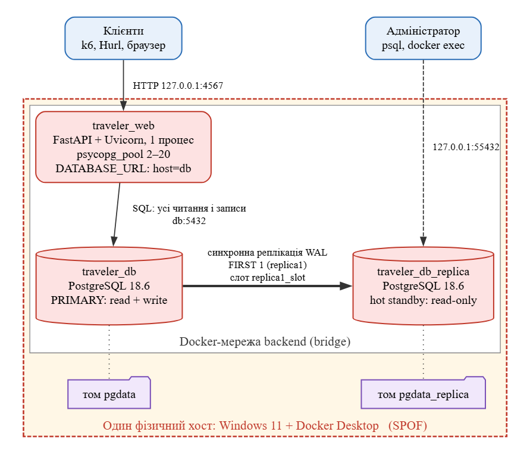

# Поточна архітектура TravelerAPI (після лабораторної роботи №4)



Джерело схеми: [diagrams/current-architecture.dot](diagrams/current-architecture.dot)

## Компоненти

| Компонент | Технологія | Роль | Доступ |
| --- | --- | --- | --- |
| traveler_web | Python 3.15, FastAPI, Uvicorn (1 процес), psycopg_pool 2–20 | REST API, усі запити до БД йдуть на `db` | 127.0.0.1:4567 |
| traveler_db | PostgreSQL 18.6, postgres:18-alpine | primary: усі читання і записи | лише мережа backend |
| traveler_db_replica | PostgreSQL 18.6, postgres:18-alpine | фізична потокова репліка, hot standby, лише читання | 127.0.0.1:55432 |
| pgdata, pgdata_replica | Docker volumes | дані primary і репліки на одному диску хоста | — |
| backend | Docker bridge network | мережа між контейнерами | — |

## З'єднання

| Звідки | Куди | Протокол / параметри |
| --- | --- | --- |
| Клієнти (k6, Hurl) | traveler_web | HTTP 127.0.0.1:4567 |
| traveler_web | traveler_db | PostgreSQL, `DATABASE_URL=postgresql://...@db:5432/traveler` (фіксоване ім'я хоста) |
| traveler_db | traveler_db_replica | синхронна фізична реплікація WAL, `synchronous_standby_names = 'FIRST 1 (replica1)'`, `synchronous_commit = on`, слот `replica1_slot` |
| Адміністратор | traveler_db_replica | psql через 127.0.0.1:55432 або `docker exec` |

## Що відсутнє

- автоматичне виявлення збою і підвищення репліки;
- маршрутизація підключень застосунку до актуального primary;
- моніторинг, алерти, журнал подій кластера;
- резервні копії та архів WAL;
- другий екземпляр застосунку і другий хост.

## Перевірка відмови primary

```powershell
docker compose up -d
docker compose ps
docker stop traveler_db
curl.exe -i http://127.0.0.1:4567/health
curl.exe -i http://127.0.0.1:4567/api/travel-plans
docker exec traveler_db_replica psql -U traveler -d traveler -c "SELECT pg_is_in_recovery();"
docker compose ps
docker start traveler_db
docker restart traveler_web
```

Результат перевірки: після зупинки `traveler_db` endpoint `/health` повертає `503 Service Unavailable` (`status = unhealthy`), `GET /api/travel-plans` — `500 Internal Server Error`, а репліка залишається в режимі recovery (`pg_is_in_recovery() = t`): дані є, але ніхто не переводить її в primary і застосунок про неї не знає. Після повернення primary застосунок сам не відновився: пул з'єднань тримав розірвані з'єднання, `/health` повертав 503, і `traveler_web` довелося перезапустити вручну.
