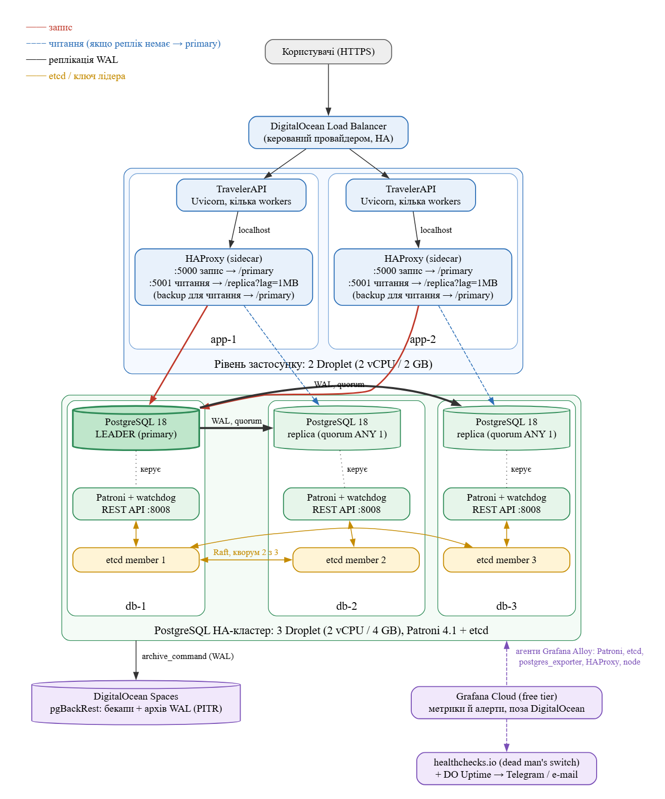
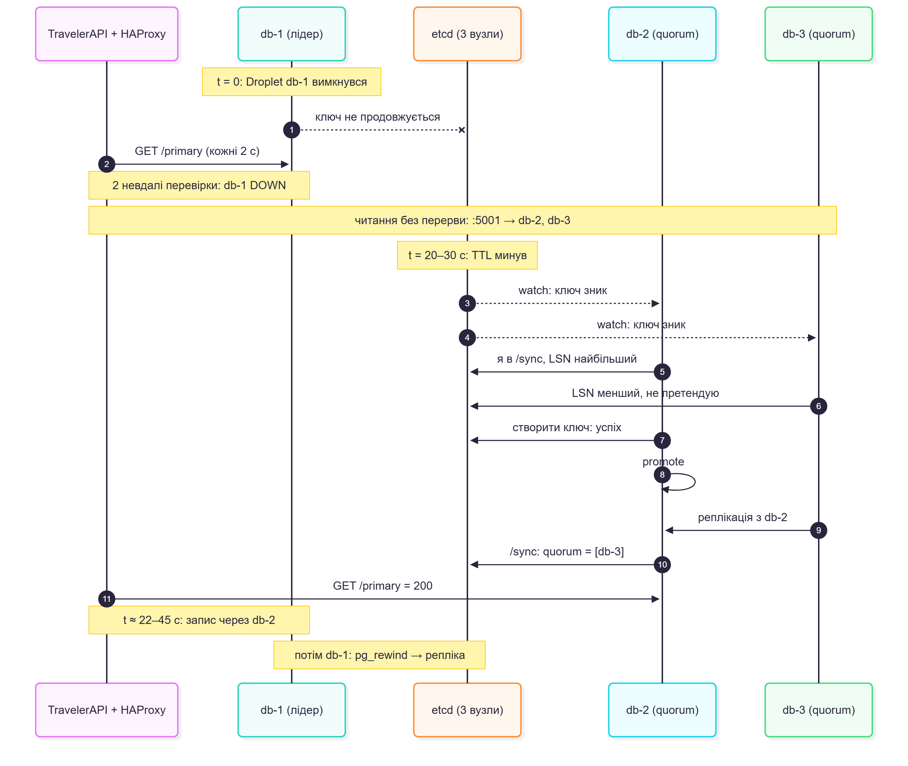

# Обране рішення: Patroni + etcd + HAProxy (варіант 5, Read-Heavy)

## Цільова архітектура



Джерело: [diagrams/target-architecture.dot](diagrams/target-architecture.dot)

| Рівень | Компоненти | Кількість |
| --- | --- | --- |
| Вхід | DigitalOcean Load Balancer (керований, HA) | 1 |
| Застосунок | Droplet 2 vCPU / 2 GB: TravelerAPI (Uvicorn, кілька workers) + HAProxy як sidecar на localhost | 2 |
| БД | Droplet 2 vCPU / 4 GB: PostgreSQL 18 + Patroni 4.1.x + watchdog (softdog) + член etcd | 3 |
| Резервні копії | pgBackRest: повні/диференційні бекапи і архів WAL у DigitalOcean Spaces, PITR | 1 бакет |
| Спостереження | агенти Grafana Alloy → Grafana Cloud (free tier); healthchecks.io як dead man's switch; DigitalOcean Uptime для публічного API | поза кластером |

## Маршрутизація

| Порт HAProxy | Призначення | Перевірка Patroni |
| --- | --- | --- |
| 127.0.0.1:5000 | запис: POST, PUT, DELETE, GET з `?consistency=strong` | `GET /primary` |
| 127.0.0.1:5001 | читання: звичайні GET (≈ 95 % запитів) | основні сервери `GET /replica?lag=1MB`; кожен вузол ще раз як `backup` з `GET /primary` |

Якщо обидві репліки недоступні, читання автоматично йде на primary. Якщо недоступний primary, читання не переривається: репліки обслуговують його й під час failover.

## Ключові налаштування Patroni

```yaml
ttl: 30
loop_wait: 10
retry_timeout: 10
primary_start_timeout: 60
maximum_lag_on_failover: 1048576
synchronous_mode: quorum
synchronous_node_count: 1
synchronous_mode_strict: true
failsafe_mode: false
postgresql:
  use_pg_rewind: true
  use_slots: true
  parameters:
    synchronous_commit: "on"
    wal_sender_timeout: 15s
    max_slot_wal_keep_size: 10GB
    hot_standby_feedback: "on"
watchdog:
  mode: required
  device: /dev/watchdog
  safety_margin: 5
```

Перевірка правила Patroni: `loop_wait + 2 · retry_timeout = 10 + 2 · 10 = 30 ≤ ttl = 30`.

HAProxy: `inter 2s fall 2 rise 1`, `on-marked-down shutdown-sessions`.

Застосунок: два пули psycopg_pool (`DATABASE_WRITE_URL=...@127.0.0.1:5000`, `DATABASE_READ_URL=...@127.0.0.1:5001`) з `check=ConnectionPool.check_connection`; `/health/live` і `/health/ready`; PUT і POST повертають оновлений ресурс з новою `version`; optimistic locking перевіряється лише на primary; ключ ідемпотентності для POST.

## Розрахунок RTO



Джерело: [diagrams/failover-sequence.mmd](diagrams/failover-sequence.mmd)

Раптова відмова Droplet з primary (Patroni зникає разом із PostgreSQL):

- ключ лідера живе ще від `ttl − loop_wait = 20 с` до `ttl = 30 с`;
- репліки помічають зникнення ключа через watch або на наступному циклі (0–10 с);
- вибір кандидата за /sync і LSN, `pg_promote()` — 1–3 с;
- HAProxy бачить новий primary за `rise · inter = 2 с`.

`RTO_запис = 20…30 + 0…10 + 1…3 + 0…2 ≈ 22–45 с < 120 с`.

Падіння лише PostgreSQL при живому Patroni, якщо PostgreSQL не вдається перезапустити: `loop_wait + primary_start_timeout + loop_wait + promote + HAProxy = 10 + 60 + 10 + 3 + 2 = 85 с < 120 с`. Якщо перезапуск вдався — failover не потрібен, пауза запису ≈ 10–40 с.

`RTO_читання ≈ 0 с`: репліки продовжують обслуговувати порт 5001.

Значення розрахункові, їх треба підтвердити хаос-тестом на стенді.

## RPO

`synchronous_mode: quorum` з `synchronous_node_count: 1` дає `synchronous_standby_names = 'ANY 1 (db-2, db-3)'`: COMMIT чекає підтвердження від будь-якої однієї репліки. Patroni підвищує лише вузол із /sync з найбільшим LSN, тому RPO = 0 для підтверджених транзакцій. Відмова однієї репліки не зупиняє запис. `synchronous_mode_strict: true`: якщо недоступні обидві репліки, запис блокується, а читання йде на primary.

## Split-brain: розрив мережі на 20 с

Випадок А — обрив лише між db-1 і db-2: ключ лідера продовжується через кворум etcd (db-1 + db-3), failover немає, запис підтверджує db-3 (ANY 1), читання працює.

Випадок Б — db-1 повністю ізольований:

| Час | Подія |
| --- | --- |
| 0 с | db-1 втрачає зв'язок з db-2, db-3 і більшістю etcd. COMMIT на db-1 чекають підтвердження і не завершуються |
| ≤ 20 с | після невдалих спроб (`loop_wait + retry_timeout`) Patroni на db-1 переводить PostgreSQL у read-only; HAProxy прибирає вузол |
| 20–30 с | ключ лідера спливає; лише після цього db-2 або db-3 можуть стати лідером |
| 20 с | мережа відновлюється: якщо ключ ще не сплив, db-1 повертає роль primary; якщо сплив — стає реплікою через pg_rewind |

Два записуваних primary неможливі: demote старого лідера відбувається раніше, ніж спливає ключ. Якщо процес Patroni завис, watchdog перезавантажує Droplet. Читання весь час працює на репліках.

## Вагова матриця (оцінки 1–5)

| Критерій | Вага | Ручний (поточний) | repmgr + witness | pg_auto_failover | Patroni + etcd + HAProxy | Керована БД |
| --- | --- | --- | --- | --- | --- | --- |
| Доступність читання | 0,25 | 1 | 4 | 4 | 5 | 4 |
| Збереження даних (RPO) | 0,20 | 3 | 3 | 4 | 5 | 4 |
| RTO запису | 0,15 | 1 | 4 | 4 | 5 | 4 |
| Захист від split-brain | 0,15 | 2 | 3 | 3 | 5 | 5 |
| Вартість | 0,15 | 5 | 4 | 4 | 4 | 2 |
| Простота підтримки | 0,10 | 5 | 3 | 4 | 2 | 5 |
| **Підсумок** | 1,00 | **2,55** | **3,55** | **3,85** | **4,55** | **3,95** |

## Бюджет (ціни DigitalOcean, листопад 2026)

| Ресурс | Кількість × ціна, $ | $/міс |
| --- | --- | --- |
| Droplet для БД (2 vCPU / 4 GB) | 3 × 24 | 72 |
| Droplet для застосунку (2 vCPU / 2 GB) | 2 × 18 | 36 |
| Load Balancer | 1 × 12 | 12 |
| Spaces (250 GiB) | 1 × 5 | 5 |
| Grafana Cloud free, healthchecks.io free, DO Uptime | — | 0 |
| **Разом** |  | **125** |

Запас до 150 $ — 25 $: на перехід БД на Droplet з NVMe (+12 $) або на погодинний тестовий стенд.

## Які поради LLM враховано

| Рішення | Звідки |
| --- | --- |
| HAProxy як sidecar на кожному API-вузлі | ChatGPT, Gemini, Claude |
| `synchronous_mode: quorum` замість FIRST 1 | Gemini (після виправлення), Claude |
| Primary як backup у read-пулі HAProxy | Gemini; ChatGPT погодився після запитання |
| `?consistency=strong`, повернення ресурсу в PUT/POST, ETag | ChatGPT |
| `check=ConnectionPool.check_connection`, /health/live і /health/ready | Claude, ChatGPT (підтверджено експериментом) |
| `primary_start_timeout: 60` | Claude |
| `wal_sender_timeout: 15s` | ChatGPT |
| `max_slot_wal_keep_size`, `hot_standby_feedback` | Gemini, Claude |
| Зовнішній моніторинг + dead man's switch | Gemini, Claude; ChatGPT після запитання |
| Таймінги Patroni за замовчуванням через shared CPU | Claude |
| `failsafe_mode: false` | ChatGPT (Gemini і Claude радили true, див. нижче) |

`failsafe_mode` залишено вимкненим: etcd розміщено на тих самих Droplet, що й PostgreSQL, тому втрата кворуму etcd майже завжди означає втрату двох вузлів БД, коли failsafe не діє. Для варіанта 5 це прийнятно: навіть без etcd читання з усіх вузлів продовжується.
